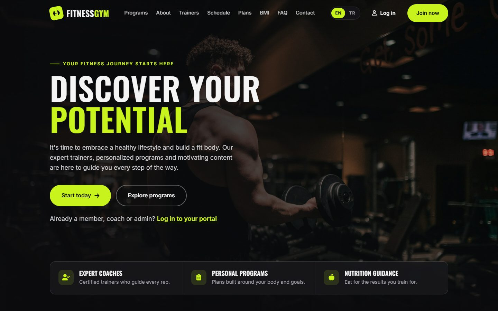
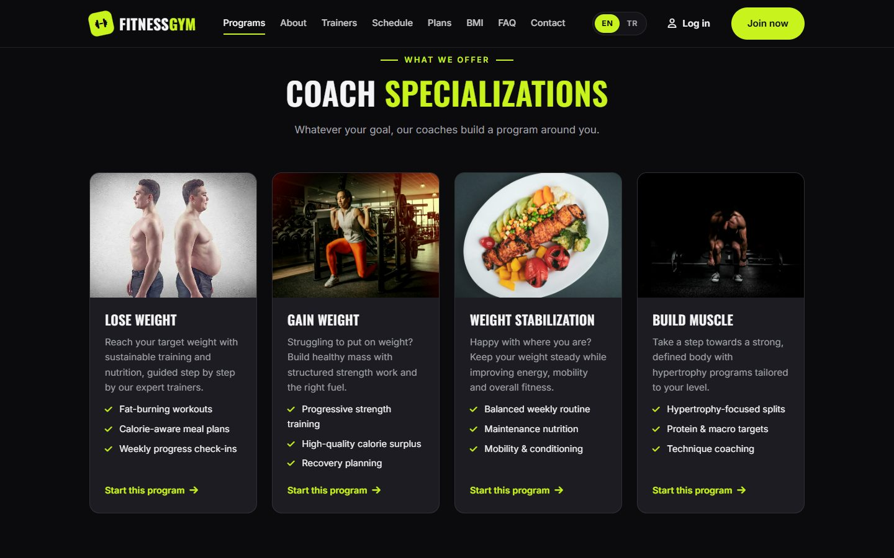
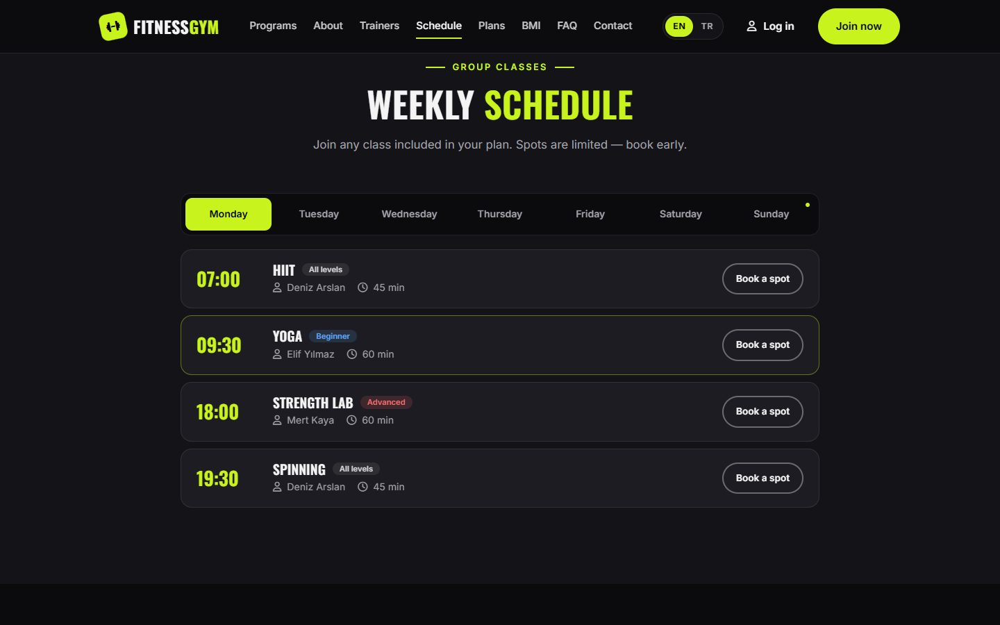
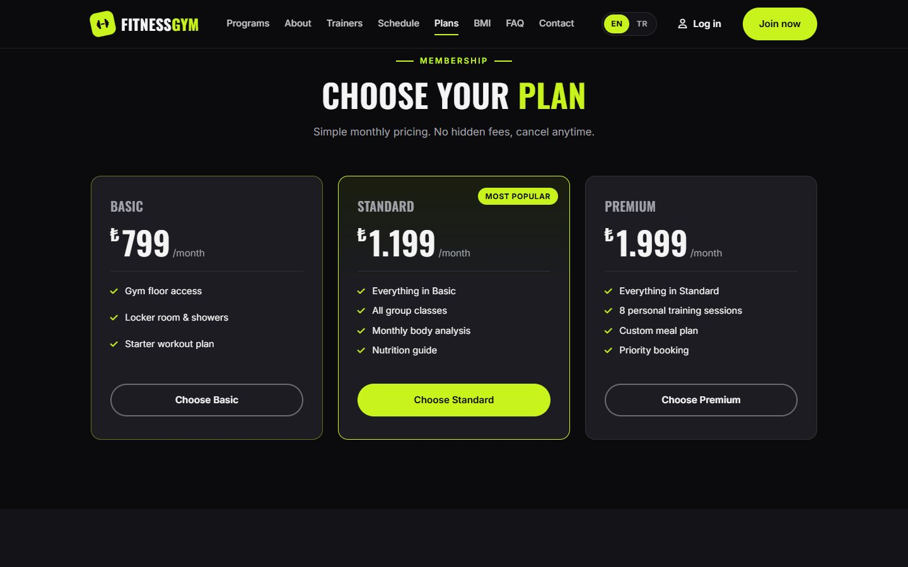
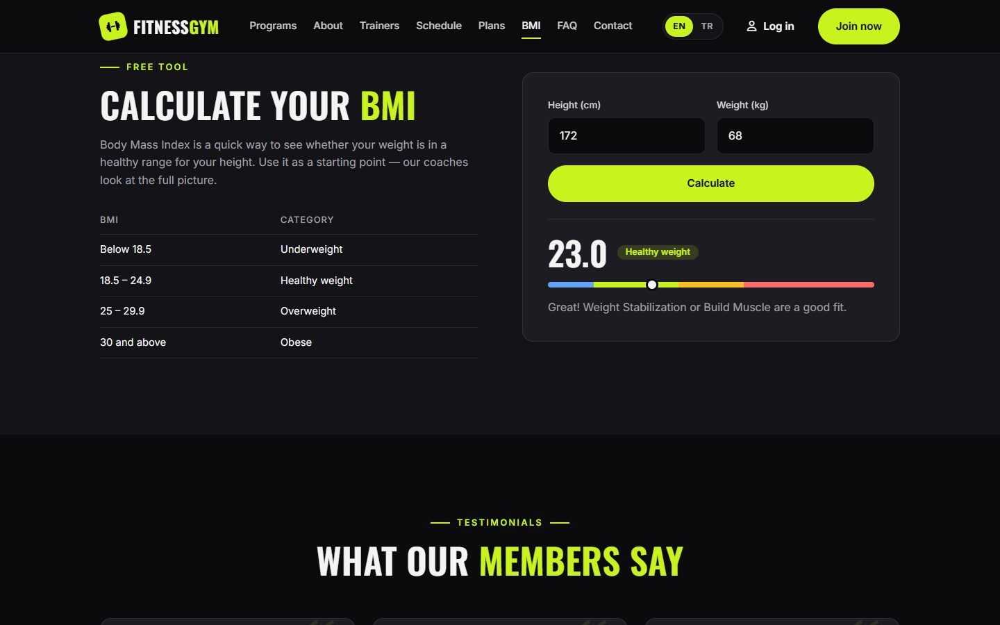
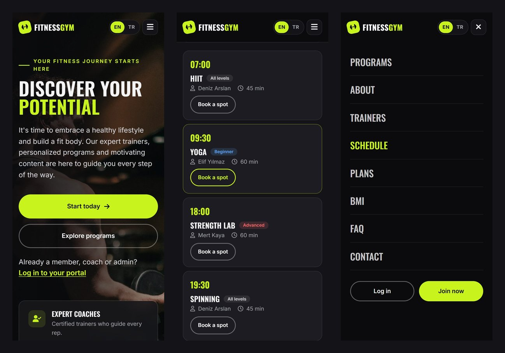

<div align="center">

# Fitness GYM

**A bilingual (English / Turkish), fully responsive gym website built with React and Vite.**

[](https://github.com/ZehraAltunok1/Fitness-Website/actions/workflows/ci.yml)
[](LICENSE)


**English** · [Türkçe](#türkçe)



</div>

## About

Fitness GYM is a single-page website for a fictional gym. It was built as a front-end design project: every
section is interactive and works in two languages, but **no backend is connected** — forms validate input and
show a confirmation, and each form is clearly labelled as a demo. Prices, trainers, the class schedule and
contact details are sample content.

## Screenshots

| Programs | Weekly schedule |
| :---: | :---: |
|  |  |
| **Membership plans** | **BMI calculator** |
|  |  |

<p align="center"><b>Mobile</b></p>



## Features

- **Two languages** — An EN / TR switch translates the whole page instantly, including validation messages.
  The browser language is detected on the first visit and the choice is remembered.
- **Sections** — Hero, programs, about, trainers, weekly class schedule, membership plans, BMI calculator,
  testimonials, FAQ, blog, contact (map + form) and sign-up.
- **Weekly class schedule** — Day tabs with time, level, trainer and duration; opens on today's classes.
- **BMI calculator** — Shows the result on a colour scale and recommends a matching program.
- **Login modal** — Client / Coach / Admin role tabs.
- **Form validation** — Full name, email, phone, minimum age (16), password strength and confirmation.
- **Connected interactions** — Choosing a plan or program pre-selects it in the sign-up form; the navbar
  highlights the section in view; sections fade in on scroll.
- **Accessibility** — Labelled form fields, keyboard navigation, `Esc` closes the modal, skip link,
  `prefers-reduced-motion` support.

## Tech stack

| | |
| --- | --- |
| UI | React 18 (function components and hooks) |
| Build | Vite |
| Tests | Vitest, React Testing Library, jsdom |
| Styling | Plain CSS with custom properties (design tokens) |
| CI | GitHub Actions — tests and production build on Node 22 and 24 |

## Getting started

Requires [Node.js](https://nodejs.org/) 22 or newer.

```bash
npm install
npm run dev
```

Then open http://localhost:3000.

| Command | Description |
| --- | --- |
| `npm run dev` | Start the development server |
| `npm test` | Run the test suite once |
| `npm run test:watch` | Run tests in watch mode |
| `npm run build` | Create a production build in `dist/` |
| `npm run preview` | Serve the production build locally |

## Project structure

```
src/
├── components/          One component per section (Navbar, Hero, Programs, Schedule, Faq, ...)
├── images/              Site images
├── App.jsx              Puts the sections together
├── LanguageContext.jsx  Language state (EN / TR)
├── i18n.js              All visible text in both languages
├── data.js              Images, prices, trainers, class schedule, links
├── hooks.js             Form state, active section and scroll-reveal hooks
└── api.js               Form submission (demo — the single place to plug in a backend)
```

## Customizing

| What to change | Where |
| --- | --- |
| Any text (EN and TR) | [`src/i18n.js`](src/i18n.js) |
| Prices, images, trainers, class schedule, contact details | [`src/data.js`](src/data.js) |
| Colours and fonts | [`src/index.css`](src/index.css) (`:root`) |
| Section styles | [`src/App.css`](src/App.css) |

Lists in `i18n.js` (programs, trainers, plans, reviews, blog posts) must be in the **same order** as the
matching lists in `data.js`.

To connect a real backend, replace `submitForm` in [`src/api.js`](src/api.js) and remove the `DemoNote`
component from the forms.

## Credits

Photos from [Unsplash](https://unsplash.com) (free to use under the [Unsplash License](https://unsplash.com/license)):
hero by [Luke Witter](https://unsplash.com/photos/k47w6BeapCs),
gain weight by [Jonathan Borba](https://unsplash.com/photos/H6wTktsFxik),
weight stabilization by [Sam Moghadam](https://unsplash.com/photos/mix6yDC_hxU),
build muscle by [Anastase Maragos](https://unsplash.com/photos/9dzWZQWZMdE).
Icons by [Font Awesome](https://fontawesome.com), fonts Inter and Oswald from [Google Fonts](https://fonts.google.com).

## License

The source code is released under the [MIT License](LICENSE). Photos are not covered by this license and
remain under their own licenses.

---

## Türkçe

**Fitness GYM**, React ve Vite ile hazırlanmış, iki dilli (İngilizce / Türkçe) ve tamamen responsive bir spor
salonu web sitesidir. Bir ön yüz (front-end) tasarım projesi olarak geliştirildi: tüm bölümler etkileşimlidir
ve iki dilde çalışır, ancak **herhangi bir backend bağlı değildir**. Formlar girilen bilgiyi doğrular ve onay
mesajı gösterir; her formda bunun bir demo olduğu belirtilir. Fiyatlar, antrenörler, ders programı ve iletişim
bilgileri örnek içeriktir.

### Özellikler

- **İki dil** — EN / TR seçiciyle tüm sayfa (hata mesajları dahil) anında çevrilir. İlk ziyarette tarayıcı
  dili algılanır, seçim hatırlanır.
- **Bölümler** — Ana sayfa, programlar, hakkımızda, antrenörler, haftalık ders programı, üyelik paketleri,
  VKİ hesaplayıcı, yorumlar, S.S.S., blog, iletişim (harita + form) ve kayıt formu.
- **Haftalık ders programı** — Gün sekmeleri; saat, seviye, antrenör ve süre bilgisi. Bugünün dersleriyle açılır.
- **VKİ hesaplayıcı** — Sonucu renkli ölçekte gösterir ve uygun programı önerir.
- **Giriş penceresi** — Üye / Koç / Yönetici rol seçimi.
- **Form doğrulama** — Ad soyad, e-posta, telefon, yaş sınırı (16), şifre gücü ve şifre tekrarı.
- **Erişilebilirlik** — Form etiketleri, klavyeyle gezinme, `Esc` ile pencere kapatma, "içeriğe geç"
  bağlantısı, azaltılmış hareket tercihine uyum.

### Kurulum

[Node.js](https://nodejs.org/) 22 veya üzeri gerekir.

```bash
npm install
npm run dev
```

Ardından http://localhost:3000 adresini açın. Testler için `npm test`, yayına hazır derleme için
`npm run build` kullanılır.

### İçeriği düzenleme

| Ne değişecek | Dosya |
| --- | --- |
| Tüm metinler (TR ve EN) | [`src/i18n.js`](src/i18n.js) |
| Fiyatlar, görseller, antrenörler, ders programı, iletişim bilgileri | [`src/data.js`](src/data.js) |
| Renkler ve yazı tipleri | [`src/index.css`](src/index.css) (`:root`) |
| Bölüm tasarımları | [`src/App.css`](src/App.css) |

`i18n.js` içindeki listeler `data.js` içindeki listelerle **aynı sırada** olmalıdır. Gerçek bir backend
bağlamak için [`src/api.js`](src/api.js) içindeki `submitForm` fonksiyonunu değiştirmek yeterlidir.

### Lisans

Kaynak kod [MIT Lisansı](LICENSE) ile yayınlanmıştır. Fotoğraflar bu lisansa dahil değildir; kendi
lisanslarına tabidir (bkz. [Credits](#credits)).

---

<div align="center">
Designed &amp; built by <b>Zehra Altunok</b> · Kocaeli University
</div>
